<div align="center">

# Axentra

**All-in-one server management for Spigot & Paper — moderation, staff tools, player protection and server health in one lightweight plugin.**

   

[Website](https://axentramc.com) · [Download](https://github.com/OlliesGitHubWorld/Axentra/releases/latest) · [Wiki](https://axentramc.com/wiki.html) · [Changelog](https://axentramc.com/changelog.html) · [Report a Bug](https://github.com/OlliesGitHubWorld/Axentra/issues/new?template=bug_report.md) · [Request a Feature](https://github.com/OlliesGitHubWorld/Axentra/issues/new?template=feature_request.md)

</div>

---

## Why Axentra?

- **One plugin instead of ten** — punishments, staff mode, vanish, homes, warps, RTP, chat tools and server monitoring
- **110+ commands, 30 modules** — turn off anything you don't need and its commands disappear completely
- **No dependencies** — drop in the jar and go; data is stored in a local SQLite database
- **Built for performance** — async database access, cached mute and freeze checks, and a WAL-mode database
- **Fully configurable** — every message, GUI template and threshold lives in plain YAML, and configs update themselves

---

## See It in Action

### Staff Mode
Vanish, teleport to players, freeze them, check their inventory and history, and punish — all from one hotbar.

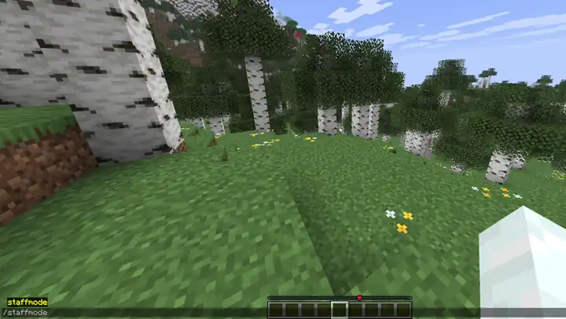

### Warps
Reorder warps with shift-click, change icons with a hotbar key, and teleport — without leaving the menu.

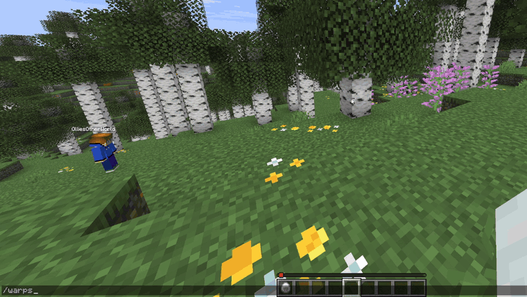

### Lag Tools
Find the heaviest chunks with `/lag chunks`, then check how the server performed over time in `/lag history`.

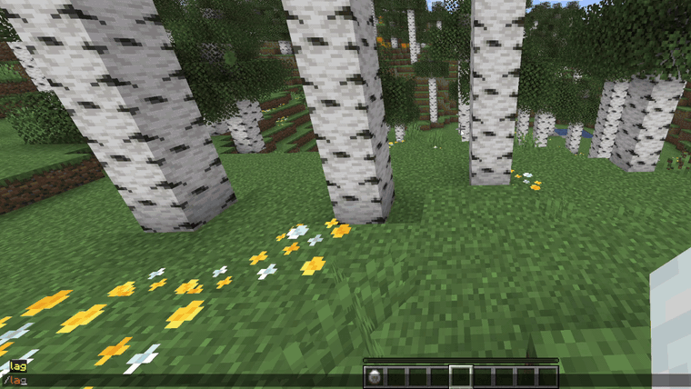

---

## Screenshots

| 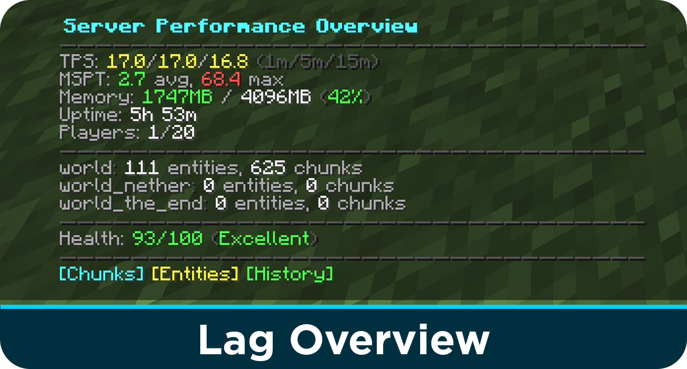 | 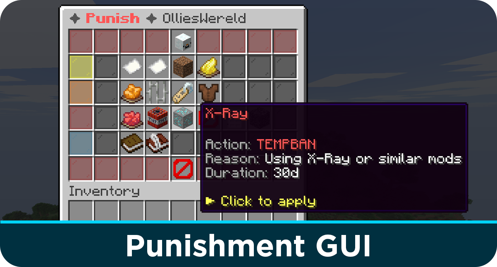 |
|:---:|:---:|
| 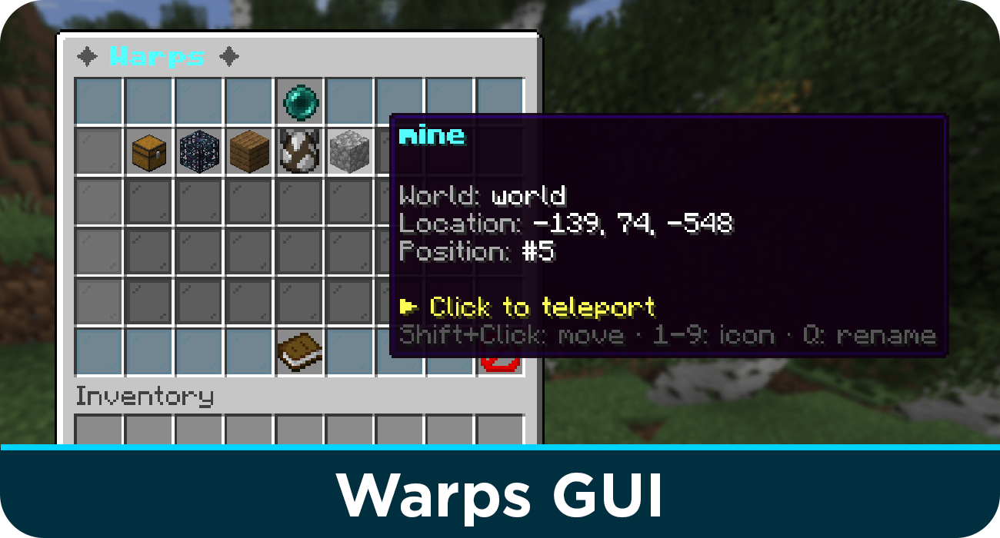 |  |
| 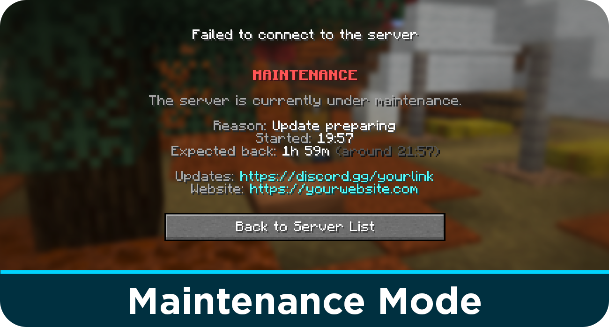 | 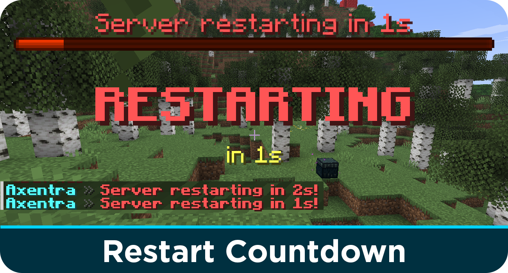 |

<details>
<summary><b>More screenshots</b></summary>

| 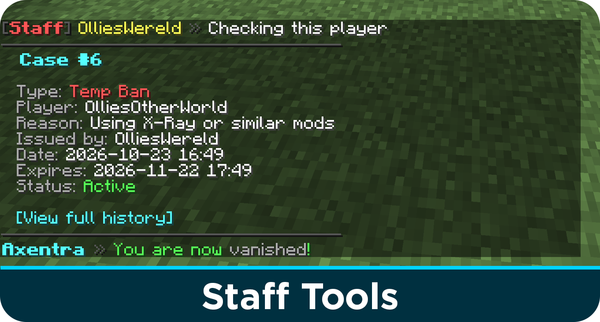 | 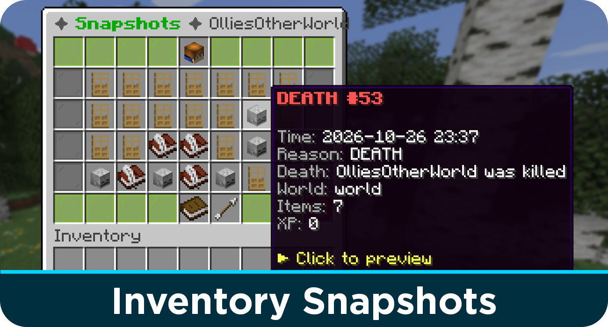 |
|:---:|:---:|
| 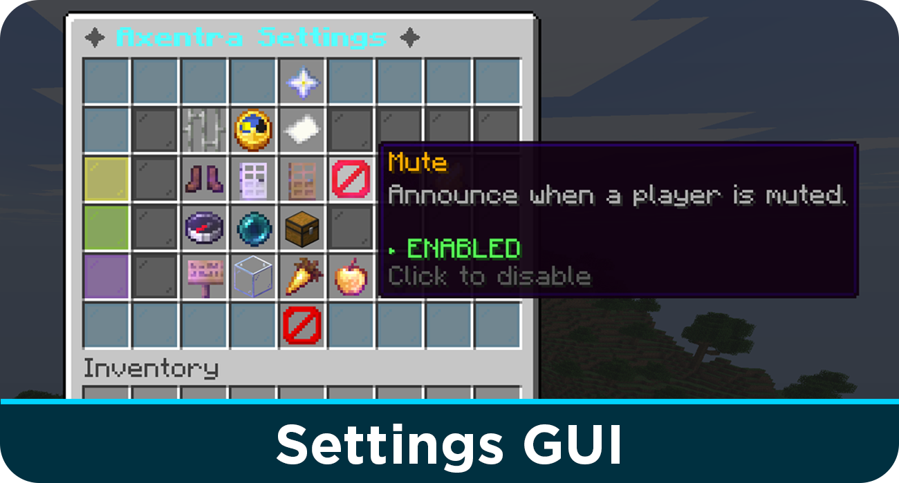 | 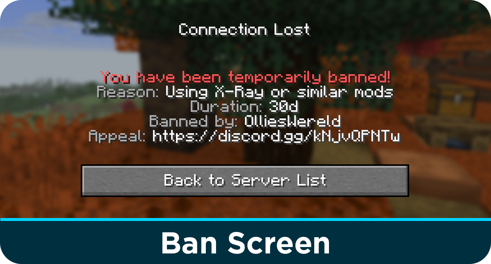 |

</details>

---

## What's New in v1.8.0 — Server Health Update

- **Server health tools** — `/lag` dashboard, lag chunks, health score, TPS history and alerts, auto cleanup and entity limits
- **Server control** — scheduled restarts with a bossbar countdown, and maintenance mode with a custom MOTD
- **Warps & RTP** — a warps GUI you can reorder, rename and re-icon in-game, plus `/rtp` (alias `/wild`)
- **Moderation** — tempfreeze, escalating punishment templates, and a fixed IP leak

Read the **[full changelog](https://axentramc.com/changelog.html)** for every change and older versions.

---

## Features

| Category | Highlights |
|---|---|
| **Moderation** | Punishment GUI with templates and escalation, case system, history GUI, staff notes, audit log, chat log snapshots |
| **Punishments** | Kick, ban, tempban, IP ban, mute, tempmute, warn, freeze — with automatic punishments at warn thresholds |
| **Player Protection** | Inventory snapshots, trust levels, alt and VPN detection, freeze and tempfreeze, player timeline |
| **Staff Tools** | Staff mode with tool hotbar, vanish, duty tracking, reports GUI, staff statistics, smart join alerts |
| **Server Health** | `/lag` dashboard, lag chunks, health score, TPS history, lag alerts, auto cleanup, entity limits |
| **Server Control** | Scheduled restarts, maintenance mode with custom MOTD and whitelist |
| **Teleportation** | Homes, warps, random teleport, spawn, `/back`, TPA requests, staff teleports |
| **Chat** | Private messages, social spy, staff chat, broadcast, mute / slow / clear chat, nicknames |
| **Utility** | Fly, heal, feed, repair, god, speed, virtual workstations, weather and time control |

See every command and permission on the **[Wiki](https://axentramc.com/wiki.html#commands)**.

---

## Getting Started

### Requirements

- **Spigot** or **Paper** 1.21+ (Paper recommended for the most accurate TPS/MSPT readings)
- **Java 21** or newer

### Installation

1. Download the latest `axentra-x.x.x.jar` from [Releases](https://github.com/OlliesGitHubWorld/Axentra/releases/latest)
2. Put it in your server's `plugins/` folder
3. Restart the server
4. Adjust the config files in `plugins/Axentra/` to your liking
5. Run `/axentra reload` to apply changes

> Turning modules on or off requires a full server restart, not just a reload.

### Quick Start

A few commands to try right after installing:

| Command | What it does |
|---|---|
| `/punish <player>` | Open the punishment GUI for a player |
| `/lag` | See TPS, MSPT, memory and the health score |
| `/lag chunks` | Find the chunks causing the most lag |
| `/setwarp spawn` | Create a warp, then open `/warps` to manage it |
| `/restart schedule 10m` | Restart in 10 minutes with a bossbar countdown |
| `/maintenance on 30m Updating plugins` | Lock the server for 30 minutes |
| `/staffmode` | Toggle staff mode with the tool hotbar |
| `/axentra settings` | Change plugin settings in-game |

### Configuration Files

| File | Contents |
|---|---|
| `config.yml` | General settings, module toggles, homes, warps, RTP |
| `messages.yml` | Every message the plugin sends |
| `punishments.yml` | Punishment GUI templates and escalation ladders |
| `protection.yml` | Snapshots, trust, alt and VPN detection, freeze |
| `health.yml` | TPS monitoring, lag chunks, alerts, cleanup, entity limits, restarts, maintenance |

When you update Axentra, new settings are added to your existing files automatically. Your own values are kept.

### Permissions

All permissions start with `Axentra.` Staff features are granted to ops by default, and everyday player features such as homes, warps and `/rtp` are available to everyone. The full list is on the [Wiki](https://axentramc.com/wiki.html).

---

## FAQ

<details>
<summary><b><code>/restart</code> restarts the server immediately and ignores my arguments</b></summary>

Spigot and Paper ship their own `/restart`, which restarts right away. Before v1.8.0 it took priority over Axentra's command — update to the latest version. Spigot's built-in restart stays available as `/spigot:restart`, also when the **restarts** module is turned off.

</details>

<details>
<summary><b>I turned a module on or off but nothing changed</b></summary>

Module toggles in `config.yml` are only applied at startup. Fully restart the server; `/axentra reload` is not enough.

</details>

<details>
<summary><b>The <code>[Frozen]</code> tag doesn't show above a player's head</b></summary>

The nametag uses the main scoreboard. Plugins that manage nametags themselves, such as TAB, can override it. The tag in the tab list and in chat still works, and each spot can be toggled in `protection.yml`.

</details>

<details>
<summary><b>What are <code>data.db-wal</code> and <code>data.db-shm</code>?</b></summary>

They belong to the database, which runs in WAL mode to avoid "database is locked" errors. This is normal — don't delete them while the server is running.

</details>

<details>
<summary><b>Staff can see players' IP addresses</b></summary>

IP addresses are only shown to players with `Axentra.alts.ip`. If a group has `Axentra.*`, set `Axentra.alts.ip` to `false` explicitly for staff that shouldn't see them.

</details>

<details>
<summary><b>My config is missing settings after an update</b></summary>

New settings are added to your files automatically on startup, with their comments. If something still looks off, rename the file and restart to generate a fresh copy, then copy your values back.

</details>

---

## Building from Source

```bash
git clone https://github.com/OlliesGitHubWorld/Axentra.git
cd Axentra
./mvnw clean package
```

The jar is written to `target/`. On Windows, use `mvnw.cmd` instead of `./mvnw`.

---

## Support & Contributing

- **Found a bug?** [Open a bug report](https://github.com/OlliesGitHubWorld/Axentra/issues/new?template=bug_report.md)
- **Have an idea?** [Request a feature](https://github.com/OlliesGitHubWorld/Axentra/issues/new?template=feature_request.md)
- **Want to help?** Pull requests are welcome — [open one here](https://github.com/OlliesGitHubWorld/Axentra/pulls)

---

## License

Axentra is released under the [MIT License](LICENSE).

<div align="center">

Made with ❤️ by [OlliesWorld](https://github.com/OlliesGitHubWorld)

</div>
